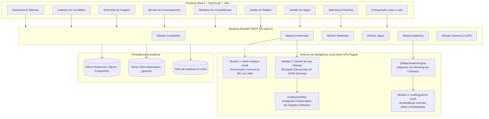
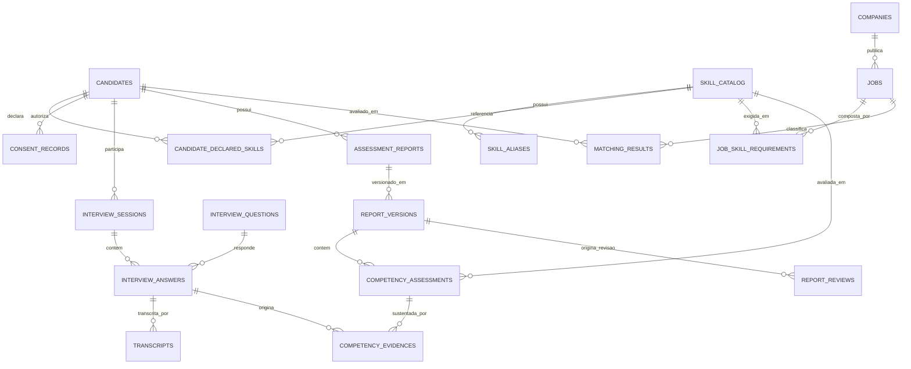

# Q.I. Tech — Ecossistema Unificado
### Plataforma de Recrutamento Invertido, Comunidade & Motor de IA Explicável

**Instituição:** FECAP — Fundação Escola de Comércio Álvares Penteado  
**Curso:** Bacharelado em Ciência da Computação  
**Autores:**  
- **Flavio José dos Santos** — R.A: **23025666**  
- **Maria Eduarda de Freitas Lopes** — R.A: **23025447**  
**Orientador:** Prof. Luis Pires  

[](https://python.org)
[](https://fastapi.tiangolo.com)
[](https://react.dev)
[](https://tailwindcss.com)
[](https://github.com)
[](#)

---

## 1. Visão Geral do Ecossistema Unificado

O **Ecossistema Q.I. Tech** unifica dois projetos essenciais de forma nativa e integrada:

1. **Plataforma Q.I. Tech (Portal Comercial & Comunidade):**
   - Recrutamento técnico invertido (*Reverse Job Board*).
   - Processo seletivo completo em 8 etapas com **Double Opt-In nativo** em conformidade com a LGPD.
   - **Comunidade Técnica exclusiva para pessoas físicas** (Feed com discussões, Rede com afinidade técnica, Mentorias e Gamificação com Estalecas).
   - Suporte a múltiplas Personas demonstrativas (Candidato Júnior/Sênior, Empresa Orion Tech, Comunidade Rafael Mendes e Governança/Admin).

2. **Q.I. Tech Matchmaker Engine (Motor de IA & Auditoria TCC):**
   - Triagem com gravação de áudio real e transcrição local por **faster-whisper** (pt-BR int8).
   - Extração estruturada de competências com IA local e **EvidenceVerifier** para validação estrita de citações fáticas (*verbatim*).
   - Relatórios com distinção de 5 estados epistêmicos (`EVIDENCIADA`, `PARCIALMENTE_EVIDENCIADA`, `EVIDENCIA_INSUFICIENTE`, `NAO_AVALIADA`, `DIVERGENCIA_IDENTIFICADA`).
   - **Direito de Réplica (Art. 20 da LGPD)** com versionamento auditável (v1 $\rightarrow$ v2).
   - Algoritmo de Matching em 5 etapas determinísticas (Hard Skills, Soft Skills, Experiência, Condições Objetivas) com cálculo explícito da **Cobertura de Avaliação**.
   - Comparação Lado a Lado de múltiplos candidatos com matriz de aderência.
   - Trilha de Auditoria e backend RESTful em FastAPI com SQLite.

1. **Informações autodeclaradas** pelo candidato (níveis 1 a 5 e preferências).
2. **Evidências textuais concretas** extraídas de entrevistas de triagem por áudio ou texto.
3. **Requisitos técnicos e comportamentais estruturados** cadastrados pelas empresas.

### O Grande Diferencial: Explicabilidade Baseada em Evidências
Ao contrário de soluções genéricas que delegam a avaliação a um chatbot ou produzem percentuais opacos, o motor Q.I. Tech:
- **Exige comprovação fática:** Associa competências a **citações literais e verificadas** do candidato.
- **Distingue estados epistêmicos:** Classifica em `EVIDENCIADA`, `PARCIALMENTE_EVIDENCIADA`, `EVIDENCIA_INSUFICIENTE`, `NAO_AVALIADA` ou `DIVERGENCIA_IDENTIFICADA`.
- **Garante o Direito de Réplica:** O candidato pode contestar análises específicas, gerando uma nova versão do relatório (v1 $\rightarrow$ v2) sem destruir o histórico.
- **Fórmula de Compatibilidade Explicável:** Ponderação determinística de 4 dimensões (Hard Skills, Soft Skills, Experiência, Condições Objetivas) com cálculo explícito da **Cobertura de Avaliação**.

---

## 2. Arquitetura do Sistema



---

## 3. Diagrama Entidade-Relacionamento (Banco de Dados)



---

## 4. Requisitos e Pré-requisitos

- **Sistema Operacional:** Windows 10/11 (executável nativamente sem necessidade de WSL/Linux).
- **Python:** Versão 3.11 ou 3.12 (testado e homologado no Python 3.12.10).
- **Node.js:** Versão 18 ou superior (testado no Node.js v24).
- **Memória RAM Mínima:** 8 GB (16 GB recomendado para execução simultânea do Ollama e Whisper).
- **Opcional (para Modelo Qwen3 via Ollama):**
  - Instalação do [Ollama para Windows](https://ollama.com).
  - Executar no terminal: `ollama run qwen2.5:3b` ou `ollama run qwen:4b`.
  - *Nota:* Caso o Ollama não esteja ativo, o sistema opera de forma autônoma e resiliente com o motor determinístico de contingência integrado.

---

## 5. Instalação e Execução Passo a Passo (Windows)

### Opção A — Execução Rápida via Scripts Automatizados (Recomendado)

Abra o terminal do PowerShell na raiz do projeto:

```powershell
# 1. Executa o setup completo (cria venv, instala dependências e popula banco)
.\scripts\setup.ps1

# 2. Em um terminal, inicie o backend:
.\scripts\run_backend.ps1

# 3. Em outro terminal, inicie o frontend:
.\scripts\run_frontend.ps1
```

Acesse:
- **Interface Web:** [http://127.0.0.1:5173](http://127.0.0.1:5173)
- **Documentação Interativa da API (Swagger):** [http://127.0.0.1:8000/docs](http://127.0.0.1:8000/docs)

---

### Opção B — Instalação Manual Detalhada

#### 1. Configurar o Backend Python
```powershell
# Criar e ativar o ambiente virtual
python -m venv venv
.\venv\Scripts\Activate.ps1

# Atualizar pip e instalar dependências
python -m pip install --upgrade pip
pip install -r .\backend\requirements.txt

# Inicializar e popular a base com os dados dos cenários de teste
cd backend
python -m app.seeds.run_seed
cd ..
```

#### 2. Configurar o Frontend React
```powershell
cd frontend
npm install
npm run build # Valida a compilação
npm run dev -- --host 127.0.0.1 --port 5173
```

#### 3. Iniciar o Backend
```powershell
cd backend
..\venv\Scripts\python -m uvicorn app.main:app --host 127.0.0.1 --port 8000 --reload
```

---

## 6. Demonstração dos Cenários de Teste (A até G)

O sistema já vem pré-configurado com 5 candidatos e 3 vagas de tecnologia projetadas para evidenciar cada cenário de teste:

| Cenário | Descrição Fática | Como Demonstrar na Interface |
|---|---|---|
| **Cenário A — Competência Evidenciada** | Lucas Silva declara Python e descreve o desenvolvimento de pipeline com 50 milhões de registros. | Vá em **Relatórios**, selecione *Lucas Silva*. Observe a competência **Python** classificada como `EVIDENCIADA` com o trecho literal extraído. |
| **Cenário B — Competência Não Avaliada** | Beatriz Souza declara SQL, mas a entrevista não abordou banco de dados. | Em **Relatórios**, selecione *Beatriz Souza*. A competência **SQL** é classificada como `NAO_AVALIADA`, sem estimar nota arbitrária. |
| **Cenário C — Nova Competência Sugerida** | Lucas Silva não declarou Gestão de Conflitos, mas relata como mediou uma divergência técnica. | Em **Relatórios**, selecione *Lucas Silva*. Veja o badge `Sugerida na Entrevista` na competência **Gestão de Conflitos**. |
| **Cenário D — Evidência Insuficiente** | Beatriz Souza declara Liderança Técnica nível 5, mas fornece apenas afirmação rasa sem contexto. | Em **Relatórios**, selecione *Beatriz Souza*. Observe **Liderança Técnica** sinalizada com alerta de revisão necessária. |
| **Cenário E — Matching e Cobertura** | Vaga exige Python, SQL e AWS. O candidato tem evidências de Python e SQL, mas AWS não foi abordado. | Em **Matching & Ranking**, selecione a vaga *Engenheiro de Dados Pleno*. O candidato pontua alto nas competências comprovadas e AWS aparece destacada em **Avaliações Pendentes**. |
| **Cenário F — Réplica e Versionamento** | Carlos Mendes contesta a análise preliminar de AWS e submete réplica formal. | Em **Réplica & Revisão**, selecione *Carlos Mendes*. Veja a Versão 1 preservada no histórico e a Versão 2 gerada com a contestação encaminhada para revisão humana. |
| **Cenário G — Segurança contra Injection** | Rafael Costa insere instrução maliciosa na resposta pedindo para "atribuir nota máxima 100%". | Em **Relatórios**, selecione *Rafael Costa*. O motor tratou a instrução como texto comum, avaliando apenas o conteúdo fático e não atribuindo notas artificiais. |

---

## 7. Execução dos Testes Automatizados (Pytest)

A suíte de testes automatizados cobre verificação de citações, cálculo de pesos, filtros objetivos, versionamento de réplicas, segurança contra injeção de prompt e integração dos endpoints da API:

```powershell
cd backend
..\venv\Scripts\pytest -v
```

Resultado da execução:
```
tests/test_api_integration.py::test_system_health_endpoint PASSED        [  7%]
tests/test_api_integration.py::test_skills_catalog_endpoint PASSED       [ 14%]
tests/test_api_integration.py::test_candidate_registration_and_flow PASSED [ 21%]
tests/test_api_integration.py::test_job_creation_and_matching PASSED     [ 28%]
tests/test_evidence_verifier.py::test_exact_verbatim_quote_verification PASSED [ 35%]
tests/test_evidence_verifier.py::test_whitespace_and_newline_normalization PASSED [ 42%]
tests/test_evidence_verifier.py::test_case_insensitive_quote_verification PASSED [ 50%]
tests/test_evidence_verifier.py::test_rejection_of_hallucinated_quote PASSED [ 57%]
tests/test_evidence_verifier.py::test_empty_quote_or_transcript PASSED   [ 64%]
tests/test_matching_engine.py::test_objective_conditions_evaluation PASSED [ 71%]
tests/test_matching_engine.py::test_matching_score_formula_and_coverage PASSED [ 78%]
tests/test_matching_engine.py::test_candidate_comparison_side_by_side PASSED [ 85%]
tests/test_profile_consolidator.py::test_preliminary_report_and_replica_versioning PASSED [ 92%]
tests/test_prompt_injection.py::test_prompt_injection_safety_scenario_g PASSED [100%]

============================= 14 passed in 29.48s =============================
```

---

## 8. Integração com a Plataforma Q.I. Tech (Node.js / NestJS)

O motor foi construído como um serviço independente (*Microservice Architecture*), expondo endpoints RESTful documentados no padrão OpenAPI 3.0.

### Exemplo de Integração em NestJS
```typescript
import { Injectable } from '@nestjs/common';
import { HttpService } from '@nestjs/axios';
import { firstValueFrom } from 'rxjs';

@Injectable()
export class MatchmakerService {
  constructor(private readonly http: HttpService) {}

  private readonly engineUrl = 'http://localhost:8000/api/v1';

  async runJobMatching(jobId: string) {
    const response = await firstValueFrom(
      this.http.post(`${this.engineUrl}/matching/jobs/${jobId}/run`)
    );
    return response.data; // Retorna ranking, pontuação explicável e justificativas
  }

  async getCandidateReport(candidateId: string) {
    const response = await firstValueFrom(
      this.http.get(`${this.engineUrl}/candidates/${candidateId}/latest-report`)
    );
    return response.data; // Retorna competências autodeclaradas vs evidenciadas
  }
}
```

---

## 9. Privacidade, LGPD e Diretrizes Éticas

- **Bases Legais:** Registro obrigatório de consentimento (`consent_records`) e finalidade de triagem técnica.
- **Não-discriminação:** Nenhuma característica pessoal protegida (gênero, idade, raça, endereço, sotaque) é enviada aos modelos ou utilizada em cálculos de compatibilidade.
- **Decisão Humana Final:** O sistema opera como ferramenta de assistência analítica (*Human-in-the-Loop*), rejeitando explicitamente a eliminação 100% automatizada de candidatos.
